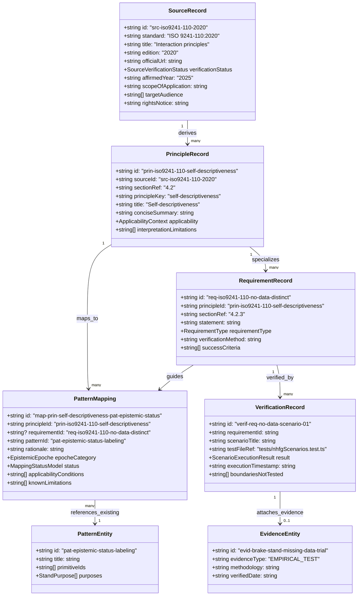

# Normative & Human Factors Guidance (NHFG) — Data Model Specification

## 1. Executive Summary & Purpose

The **Normative & Human Factors Guidance (NHFG)** layer extends **Atlas Engineering Patterns** with formal traceability between external normative standards (e.g., ISO 9241-110:2020, ISO 9241-210:2019, ISO 9241-11:2018), ergonomic principles, concrete engineering requirements, Atlas patterns (`pat-*`), verification scenarios, and empirical evidence.

The primary architectural goal is to enable an engineer or AI agent to answer:
1. **Source & Grounding**: On what authority or standard is this interface pattern proposed?
2. **Context & Boundaries**: Under what operating conditions and safety levels does this principle apply?
3. **Verification**: How can we test that the interface satisfies the requirement?
4. **Epistemic Discipline**: What has actually been verified by tests vs. what remains a design hypothesis or unconfirmed standard conformance?

---

## 2. Entity & Relationship Architecture (Mermaid Schema)



---

## 3. Logical Entity Specifications & TypeScript Definitions

### 3.1 `SourceRecord` (Normative & Technical Source)
- **Role**: Authoritative representation of an external standard or engineering specification.
- **Rules**: Must not store full copyrighted standard text; stores official metadata, verified URLs, affirmed editions, and brief summaries in original words.

```typescript
export type SourceVerificationStatus =
  | 'OFFICIAL_METADATA_VERIFIED'
  | 'DRAFT_SPECIFICATION'
  | 'HISTORICAL_OBSOLETE'
  | 'UNVERIFIED_CITATION';

export interface SourceRecord {
  id: string; // e.g. "src-iso9241-110-2020"
  standard: string; // e.g. "ISO 9241-110:2020"
  title: string;
  edition: string; // e.g. "2020"
  publicationDate: string; // ISO edition publication date, e.g. "2020-05"
  confirmedDate?: string; // Systematic review confirmation year by ISO, e.g. "2025"
  atlasVerifiedDate: string; // Date Atlas maintainers verified the official metadata, e.g. "2026-10-20"
  officialUrl: string;
  verificationStatus: SourceVerificationStatus;
  scopeSummary: string;
  targetAudience: ('system_designer' | 'software_developer' | 'requirements_analyst' | 'evaluator')[];
  safetyDisclaimer: string; // e.g. "Does not cover all safety-critical domains alone"
  rightsNotice: string; // attribution notice without copyright infringement
}
```

### 3.2 `PrincipleRecord` (Interaction & Human Factors Principle)
- **Role**: High-level interaction principle (e.g., ISO 9241-110 7 interaction principles).
- **Rules**: Explicitly links to `sourceId` and cites section number. Identifies applicability constraints (especially for safety-critical stands).

```typescript
export interface ApplicabilityContext {
  safetyCriticalContextNeedsAdditionalGuidance: boolean;
  minUserLevel: 'SECONDARY_SCHOOL' | 'UNDERGRADUATE' | 'RESEARCHER' | 'CERTIFIED_OPERATOR' | 'ALL_LEVELS';
  excludedDomains?: string[];
  mandatoryPeripherals?: string[];
}

export interface PrincipleRecord {
  id: string; // e.g. "prin-iso9241-110-self-descriptiveness"
  sourceId: string; // References SourceRecord.id
  sectionRef: string; // e.g. "4.2"
  principleKey:
    | 'suitability-for-task'
    | 'self-descriptiveness'
    | 'conformity-with-user-expectations'
    | 'learnability'
    | 'controllability'
    | 'use-error-robustness'
    | 'user-engagement';
  title: string;
  conciseSummary: string; // Paraphrased summary
  applicability: ApplicabilityContext;
  interpretationLimitations: string[];
}
```

### 3.3 `RequirementRecord` (Verifiable Interface Requirement)
- **Role**: Operationalized, testable requirement derived from principles.

```typescript
export type RequirementType =
  | 'INTERFACE_DISCLOSURE'
  | 'DATA_INTEGRITY_LABELING'
  | 'STATE_FEEDBACK'
  | 'OPERATOR_INTERLOCK'
  | 'REVERSIBLE_ACTION'
  | 'ERROR_TOLERANCE';

export interface RequirementRecord {
  id: string; // e.g. "req-iso9241-110-no-data-distinct"
  principleId: string; // References PrincipleRecord.id
  sourceId: string; // References SourceRecord.id
  sectionRef: string; // e.g. "4.2.3"
  statement: string; // Testable normative statement
  requirementType: RequirementType;
  verificationMethod: 'SCENARIO_SIMULATION' | 'AUTOMATED_ASSERTION' | 'OPERATOR_TRIAL' | 'EXPERT_INSPECTION';
  successCriteria: string[];
  safetyCritical: boolean;
}
```

### 3.4 `PatternMapping` (Traceable Link to Atlas Pattern)
- **Role**: Binds an ergonomic principle or requirement to an existing Atlas pattern (`pat-*`).
- **Critical Invariant**: Does **not** invent or duplicate pattern records. References existing `pat-*` in Atlas canonical registry.

```typescript
export type EpistemicCategory =
  | 'SOURCE_CONFIRMED'           // Directly stated in standard metadata/norm
  | 'ENGINEERING_INTERPRETATION'  // Applied engineering deduction from standard text
  | 'DESIGN_HYPOTHESIS'          // Proposed mapping awaiting empirical validation
  | 'VERIFIED_RESULT'            // Validated via executed scenario or empirical trial
  | 'UNVERIFIED_OR_UNKNOWN';     // Gap / missing evidence

export interface PatternMapping {
  id: string; // e.g. "map-prin-self-descriptiveness-pat-epistemic-status"
  principleId: string; // References PrincipleRecord.id
  requirementId?: string; // Optional reference to specific RequirementRecord.id
  patternId: string; // Strict reference to canonical pattern, e.g. "pat-epistemic-status-labeling"
  rationale: string; // Explicit engineering justification
  epistemicCategory: EpistemicCategory;
  status: MappingStatusModel;
  applicabilityConditions: string[];
  knownLimitations: string[];
}
```

### 3.5 `VerificationRecord` (Scenario & Test Evidence)
- **Role**: Concrete executable test definition or empirical run proving a specific requirement.

```typescript
export interface VerificationRecord {
  id: string; // e.g. "verif-req-no-data-scenario-01"
  requirementId: string; // References RequirementRecord.id
  scenarioTitle: string;
  testFileRef: string; // e.g. "tests/nhfgScenarios.test.ts"
  testName: string;
  passed: boolean;
  executedAt: string;
  evidenceEntityId?: string; // Optional link to existing evid-* record
  untestedBoundaries: string[]; // Honest disclosure of what the test does NOT cover
}
```

---

## 4. Multi-Dimensional Status Model (Preventing False Conformance)

### 4.1 Anti-Conflation Principle
A single linear scale (e.g. `0% -> 100%`) is dangerous and methodologically false:
- An interface passing a synthetic test (`SCENARIO_VERIFIED`) does **not** prove full usability for human operators (`USER_EVALUATED`).
- Neither a unit test nor a user trial constitutes certified standard compliance (`CONFORMANCE_NOT_ESTABLISHED`).

### 4.2 Orthogonal Status Dimensions (`MappingStatusModel`)
Every `PatternMapping` contains four orthogonal status fields:

```typescript
export type ConformanceEvaluationMethod =
  | 'NONE'
  | 'FIRST_PARTY_SELF_ASSESSMENT'
  | 'SECOND_PARTY_AUDIT'
  | 'THIRD_PARTY_CERTIFICATION';

export interface MappingStatusModel {
  /** 1. Engineering / Architectural justification */
  designRationaleStatus: 'NOT_ASSESSED' | 'DESIGN_RATIONALE_PROVIDED';

  /** 2. Deterministic execution in automated scenario tests */
  scenarioVerificationStatus: 'NOT_ASSESSED' | 'SCENARIO_VERIFIED' | 'SCENARIO_FAILED';

  /** 3. Human subject trials with representative target operators */
  userEvaluationStatus: 'NOT_ASSESSED' | 'USER_EVALUATED' | 'USER_EVALUATION_FAILED';

  /** 4. Formal normative standard conformance */
  conformanceStatus: 'CONFORMANCE_NOT_ESTABLISHED' | 'CONFORMANCE_CLAIMED';

  /** Applicable evaluation method if conformance is claimed */
  conformanceMethod?: ConformanceEvaluationMethod;
}
```

### 4.3 Allowed Combinations & Invalidation Rules

| `designRationaleStatus` | `scenarioVerificationStatus` | `userEvaluationStatus` | `conformanceStatus` | `conformanceMethod` | Valid? | Interpretation |
| :--- | :--- | :--- | :--- | :--- | :---: | :--- |
| `NOT_ASSESSED` | `NOT_ASSESSED` | `NOT_ASSESSED` | `CONFORMANCE_NOT_ESTABLISHED` | `NONE` | **YES** | Initial state / hypothesis. |
| `DESIGN_RATIONALE_PROVIDED` | `NOT_ASSESSED` | `NOT_ASSESSED` | `CONFORMANCE_NOT_ESTABLISHED` | `NONE` | **YES** | Architectural rationale articulated. |
| `DESIGN_RATIONALE_PROVIDED` | `SCENARIO_VERIFIED` | `NOT_ASSESSED` | `CONFORMANCE_NOT_ESTABLISHED` | `NONE` | **YES** | Automated scenario test passed in simulation. |
| `DESIGN_RATIONALE_PROVIDED` | `SCENARIO_VERIFIED` | `USER_EVALUATED` | `CONFORMANCE_NOT_ESTABLISHED` | `NONE` | **YES** | Operator trials conducted; broad standard conformance still not claimed. |
| `DESIGN_RATIONALE_PROVIDED` | `SCENARIO_VERIFIED` | `USER_EVALUATED` | `CONFORMANCE_CLAIMED` | *Valid Method* | **YES** | Legitimate conformance claimed via documented evaluation procedure. |
| `*` | `NOT_ASSESSED` | `NOT_ASSESSED` | `CONFORMANCE_CLAIMED` | `*` | **NO (INVALID)** | Forbidden: Conformance cannot be claimed without verified scenarios and an evaluation method. |
| `NOT_ASSESSED` | `SCENARIO_VERIFIED` | `*` | `*` | `*` | **NO (INVALID)** | Forbidden: Scenario cannot pass without documented design rationale and requirement. |

**Automated Guardrail Function**:
```typescript
export function validateMappingStatus(status: MappingStatusModel): { valid: boolean; error?: string } {
  if (status.conformanceStatus === 'CONFORMANCE_CLAIMED') {
    if (!status.conformanceMethod || status.conformanceMethod === 'NONE') {
      return {
        valid: false,
        error: 'Standard conformance claim requires an explicit evaluation method (e.g., self-assessment, 2nd party audit, or 3rd party certification).'
      };
    }
    if (status.scenarioVerificationStatus !== 'SCENARIO_VERIFIED') {
      return {
        valid: false,
        error: 'Standard conformance cannot be claimed without verified scenario evidence.'
      };
    }
    if (status.designRationaleStatus !== 'DESIGN_RATIONALE_PROVIDED') {
      return {
        valid: false,
        error: 'Standard conformance cannot be claimed without a documented design rationale.'
      };
    }
  }
  if (status.scenarioVerificationStatus === 'SCENARIO_VERIFIED' && status.designRationaleStatus === 'NOT_ASSESSED') {
    return {
      valid: false,
      error: 'Cannot have a verified scenario without an assessed design rationale.'
    };
  }
  return { valid: true };
}
```

---

## 5. Stable Identifier Rules

To guarantee zero ID collision with the 53 existing canonical records and future entities:

| Entity Type | Prefix | Format Pattern | Example |
| :--- | :--- | :--- | :--- |
| **Source Record** | `src-` | `src-<standard>-<year>` | `src-iso9241-110-2020`, `src-iso9241-210-2019` |
| **Principle Record** | `prin-` | `prin-<standard>-<principleKey>` | `prin-iso9241-110-self-descriptiveness` |
| **Requirement Record** | `req-` | `req-<standard>-<shortDescriptionKey>` | `req-iso9241-110-no-data-distinct` |
| **Pattern Mapping** | `map-` | `map-<principleKey>-<patternId>` | `map-prin-self-descriptiveness-pat-epistemic-status` |
| **Verification Record** | `verif-` | `verif-<requirementId>-<scenarioKey>` | `verif-req-no-data-scenario-01` |

**Validation Rules**:
1. All IDs must be strictly lowercase, alphanumeric with hyphens.
2. Must never overlap with `prim-*`, `pat-*`, `cfg-*`, `impl-*`, `evid-*`.
3. Every `patternId` referenced in `PatternMapping` **must exist** in `ALL_CANONICAL_ENTITIES`.

---

## 6. Backward Compatibility & Non-Disruption Strategy

1. **Isolation in Dedicated Module (`src/atlas/nhfgData.ts`)**:
   - The 53 records in `src/atlas/canonicalData.ts` remain unchanged.
   - Core `ALL_CANONICAL_ENTITIES` retains its 5 types (`primitive`, `pattern`, `configuration`, `implementation`, `evidence`).
   - The 12 criteria in `AuditEngine` continue to evaluate `ALL_CANONICAL_ENTITIES` cleanly.
2. **Overlay Graph / Non-Breaking Linkage**:
   - `PatternMapping` points to `pat-*` by ID.
   - `EvidenceEntity` (`evid-*`) can be referenced from `VerificationRecord` without altering the `evidence` schema.
3. **Graph Engine (`src/atlas/graphEngine.ts`)**:
   - Core graph remains focused on construction topology (`USES`, `COMPOSES_WITH`, `REQUIRES`, `CONFLICTS_WITH`).
   - A dedicated `NhfgRegistry` class handles normative queries (`getPrinciplesForPattern(patternId)`, `getUnmetRequirements()`).

---

## 7. Verification & Test Plan

A new test file `tests/nhfg.test.ts` will verify:
1. **Uniqueness**: All `src-*`, `prin-*`, `req-*`, `map-*`, `verif-*` IDs are globally unique.
2. **Referential Integrity**:
   - Every `PrincipleRecord.sourceId` matches an existing `SourceRecord`.
   - Every `RequirementRecord.principleId` matches an existing `PrincipleRecord`.
   - Every `PatternMapping.patternId` matches an existing pattern in `ALL_CANONICAL_ENTITIES`.
   - Every `PatternMapping.principleId` matches an existing `PrincipleRecord`.
3. **Status Guardrails**:
   - `validateMappingStatus()` rejects illegal status transitions (e.g. claiming conformance without operator evaluations).
4. **End-to-End Traceability**:
   - Verify complete chain: `Source (ISO 9241-110)` -> `Principle (Self-descriptiveness)` -> `Requirement (No data distinct)` -> `Pattern (pat-epistemic-status-labeling)` -> `Verification (test assertion)` -> `Evidence`.

---

## 8. Open Questions & Future Considerations

1. **Safety Standards Integration**:
   - *Question*: How should ISO 13849-1 / IEC 61508 (Functional Safety) or ISO 9241-110's safety disclaimer be handled when a stand is `HAZARDOUS_FACILITY`?
   - *Resolution*: Principle applicability explicitly flags `safetyCriticalContextNeedsAdditionalGuidance: true`, forcing Atlas to require hardware interlock patterns (`pat-dual-interlock`) and flag epistemic loss if safety certifications are absent.
2. **Regional Standard Alignment**:
   - *Question*: How to integrate national standards (e.g., DSTU / GOST) alongside ISO?
   - *Resolution*: Modeled cleanly as additional `SourceRecord` entries (e.g., `src-dstu-...`) without altering the `PrincipleRecord` or `PatternMapping` architecture.
